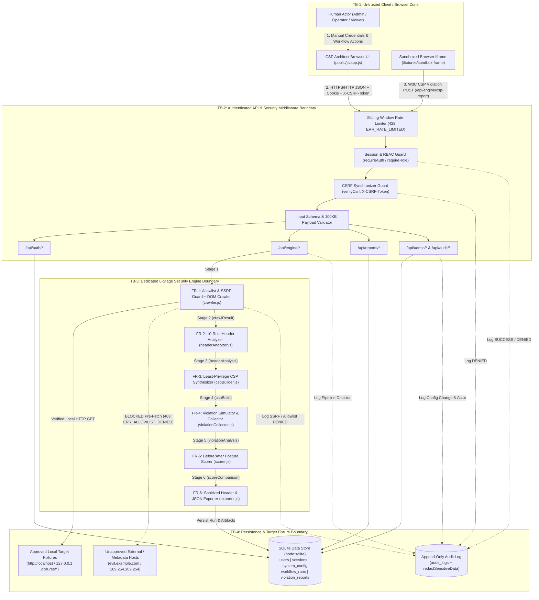
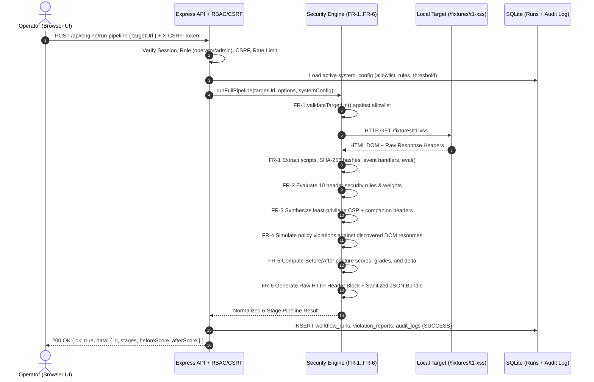

# System Architecture & Data-Flow Diagram (DFD)

**Project:** Proposal 38 — CSP Architect: Browser Security Header Workbench  
**Course / Group:** Class 3, Group 6 | **Domain:** Web Security  
**Authors:** Tayyab Khalid (Lead/QA), Abdul Nafay Khan Burki (Backend/Auth), Muhammad Ibrahim Alam (Security Engine), Fasih Ur Rehman (Frontend/Reporting)

---

## 1. Architectural Overview (5-Layer Defense-in-Depth Model)

CSP Architect is engineered as a modular, five-layer local security workbench that crawls approved local web applications, evaluates HTTP browser security headers against a 10-rule policy matrix, synthesizes least-privilege Content Security Policy (CSP) headers with cryptographic SHA-256 hashes, simulates and captures real browser W3C CSP violation reports, computes explainable before/after posture scores, and exports deployment-ready HTTP header blocks and sanitized JSON evidence reports.

### Layer Breakdown

| Layer | Name | Primary Modules | Core Responsibilities & Security Controls |
| :--- | :--- | :--- | :--- |
| **Layer 1** | **User / Browser Interface** | `public/index.html`, `public/css/styles.css`, `public/js/app.js` | Manual authentication login view (zero hardcoded/prefilled credentials in UI), 6-stage interactive & 1-click pipeline controls, live browser CSP violation sandbox (`<iframe>`), side-by-side run comparison, and role-aware Admin/Audit console. |
| **Layer 2** | **Application / API & Security Gateway** | `src/app.js`, `src/middleware/security.js`, `src/routes/auth.js`, `src/routes/admin.js`, `src/routes/audit.js`, `src/routes/reports.js`, `src/routes/engine.js` | Session cookie validation (`HttpOnly`, `SameSite=Strict`), Role-Based Access Control (`admin`, `operator`, `viewer`), synchronizer-token CSRF verification (`X-CSRF-Token`), sliding-window rate limiting (`429 ERR_RATE_LIMITED`), strict JSON schema & payload size validation (`100kb` limit), and stack-trace-free error normalization. |
| **Layer 3** | **Dedicated Security Engine (`FR-1`–`FR-6`)** | `src/engine/crawler.js`, `src/engine/headerAnalyzer.js`, `src/engine/cspBuilder.js`, `src/engine/violationCollector.js`, `src/engine/scorer.js`, `src/engine/exporter.js`, `src/engine/index.js` | Pre-fetch SSRF/allowlist validation (`localhost` / `127.0.0.1`), Cheerio DOM resource & SHA-256 hash extraction (`FR-1`), 10-rule weighted header analysis (`FR-2`), least-privilege CSP synthesis (`FR-3`), deterministic + browser W3C violation collection (`FR-4`), before/after posture scoring (`FR-5`), and sanitized artifact generation (`FR-6`). |
| **Layer 4** | **Data Store & Append-Only Audit Log** | `src/db/database.js`, `src/repositories/repo.js`, `src/contracts/schemas.js` | Built-in `node:sqlite` (`DatabaseSync`) relational persistence for `users`, `sessions`, `system_config`, `workflow_runs`, `violation_reports`, and immutable `audit_logs` with recursive sensitive-key redaction (`redactSensitiveData`). |
| **Layer 5** | **Local Target Fixtures & Evaluation Harness** | `src/fixtures/fixturesRouter.js`, `tests/evaluation_t1_t6.test.js`, `tests/security_t_final.test.js`, `scripts/run_evaluation.js` | Self-contained local vulnerable and hardened target endpoints (`/fixtures/normal-safe`, `t1-xss` through `t6-allowlist`, `sandbox-frame`) and automated verification suites measuring Rule Coverage, False Positive Rate, False Negative Rate, and Decision Latency. |

---

## 2. Data-Flow Diagram (DFD) with Explicit Trust Boundaries

The following Mermaid Data-Flow Diagram illustrates how requests, credentials, CSRF tokens, target HTML/headers, and sanitized audit records traverse the four explicit trust boundaries (`TB-1` through `TB-4`).

---

## 3. Trust Boundaries & Enforcement Mechanisms

1. **`TB-1 -> TB-2` (Browser Client to Express API Gateway):**
   - All incoming HTTP traffic is untrusted.
   - `express.json({ limit: '100kb' })` enforces strict payload bounds (`413 ERR_PAYLOAD_TOO_LARGE` on violation).
   - `createRateLimiter` throttles credential brute-forcing and pipeline flooding (`429 ERR_RATE_LIMITED`).
   - `attachSession` + `requireAuth` verify the SHA-256 hashed session token in SQLite (`401 ERR_AUTH_REQUIRED`).
   - `requireRole` enforces strict separation of duties between `admin`, `operator`, and `viewer` (`403 ERR_AUTH_FORBIDDEN`).
   - `verifyCsrf` validates the per-session `X-CSRF-Token` header on all state-mutating requests (`403 ERR_CSRF_INVALID`).

2. **`TB-2 -> TB-3` (API Gateway to Dedicated Security Engine):**
   - Only authenticated `operator` or `admin` requests reach the active crawling and synthesis pipeline.
   - Current `system_config` (allowlist, pass score threshold, enabled rules, and weights) is loaded from SQLite and injected deterministically into each engine invocation.

3. **`TB-3 -> TB-4` (Security Engine Crawler to Target Network / Fixtures):**
   - `validateTargetUrl(targetUrl, systemConfig)` parses the candidate URL via the WHATWG `URL` parser prior to opening any network socket.
   - Non-HTTP(S) schemes (`file:`, `javascript:`, `data:`, `gopher:`), embedded URL credentials, and any hostname outside `systemConfig.allowlist` (`localhost`, `127.0.0.1`) are immediately rejected with `403 ERR_ALLOWLIST_DENIED` and recorded in `audit_logs`.

4. **`TB-2 / TB-3 -> TB-4` (Application & Engine to SQLite Persistence & Audit Trail):**
   - Every SQL query uses parameterized prepared statements (`db.prepare(...)`) to prevent SQL injection.
   - `redactSensitiveData()` scrubs passwords, session tokens, CSRF tokens, cookies, and authorization headers before writing `details_json` to `audit_logs` or exporting JSON reports.
   - `audit_logs` is strictly append-only (`INSERT` only; no `UPDATE` or `DELETE` paths exist in `repo.js`).

---

## 4. End-to-End 6-Stage Pipeline Sequence

